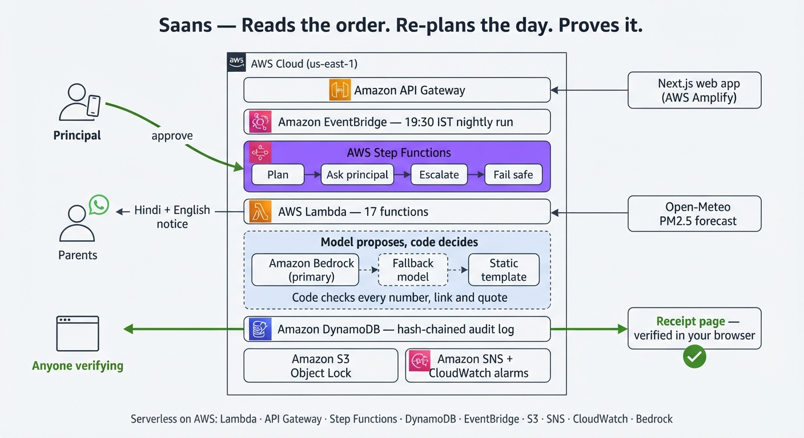

# Saans (साँस) — System Architecture

This document provides a formal, in-depth architectural breakdown of the **Saans (साँस)** air-safety school day re-planning and verification platform.

---

## High-Level Cloud Architecture

The Saans backend is deployed as a serverless application in `us-east-1` via AWS CloudFormation / SAM, paired with a Next.js 16 frontend hosted on AWS Amplify.

<p align="center">
  
</p>

---

## End-to-End Operational Lifecycle (The 6 Steps)

### Step 1: Automated Trigger (EventBridge)
* **Nightly Run (19:30 IST):** EventBridge schedule triggers `TriggerFunction` to plan the upcoming school day. The Step Functions execution name is set to the unique `decision_id` (`TENANT#<id>#<date>#<session>`), guaranteeing idempotency (duplicate executions for the same date/session are refused).
* **Forecast Watch (16:30 IST):** Daily proactive evaluation rehearsing the next 48 hours to generate uncommitted contingency plans.
* **Audit Anchor (23:55 IST):** Nightly schedule triggering `AnchorFunction` to lock the day's audit head into S3 Object Lock.

### Step 2: Deterministic Decision & Human-in-the-Loop (Step Functions + SNS)
* `IngestPlannerFunction` loads the active statutory ruleset, school timetable, room ventilation factors, and Open-Meteo CAMS forecast.
* The deterministic planner classifies all periods. If outdoor physical education is impacted, it re-plans the day:
  * **Plan A:** Swaps outdoor PE to a cleaner, permitted time slot.
  * **Plan B:** Relocates outdoor PE to the cleanest available indoor hall or classroom.
* If changes are required, `RequestApprovalFunction` generates an opaque, role-bound, single-use token (`TOKEN#<short_id>`) with a 120s TTL and pauses the Step Functions execution via `waitForTaskToken`.
* An approval link is dispatched to the school principal via **Amazon SNS (Email / SMS)**.
* **Escalation & Fail-Safe Invariant:** If the principal does not respond within 60 seconds, the workflow escalates to the vice-principal. If the vice-principal rejects or times out, the workflow enters `fail_safe`: **zero notifications are dispatched**, and the incident is recorded in the ledger.

### Step 3: Sovereign Approval & AI Generation (Bedrock + Code Checks)
* The principal opens the 60-second brief on their phone and approves.
* `ApprovalFunction` validates the token, consumes it with a conditional write, and resumes the Step Functions execution via `states:SendTaskSuccess`.
* **The Model Proposes, Code Decides:**
  * **Amazon Bedrock (Nova Lite via Converse API)** drafts personalized bilingual notices (English + Hindi).
  * **Failover Hierarchy:** If Bedrock is unavailable, traffic fails over to a labelled Groq Llama-3 model; if both fail, it falls back to a deterministic bilingual static template.
  * **Strict Code Guardrails:** The generated draft is evaluated by `services/notify/output_check.py`:
    1. *Number Whitelist:* Every digit must appear in the verified plan fact sheet (prevents hallucinated numbers).
    2. *Receipt Link Lock:* The only URL permitted is this decision's public receipt link.
    3. *Devanagari Script Check:* Hindi text must consist of authentic Devanagari Unicode.
    4. *Character Limit:* Draft must not exceed 700 characters.
    5. Any violation causes immediate rejection and fallback to the static template.

### Step 4: Multi-Channel Dispatch (WhatsApp)
* Verified notices are prepared for distribution:
  * **Class Teachers:** Provided with WhatsApp Click-to-Share links to send directly to their class parent groups.
  * **Automated Demo Delivery:** When configured, parent notices are delivered directly via **Meta WhatsApp Cloud API** (or Twilio WhatsApp Sandbox).
  * No student or parent phone numbers are permanently stored in the system.

### Step 5: Cryptographic Ledger & WORM Storage (DynamoDB + S3 Object Lock)
* Every system transition is appended to an append-only cryptographic hash chain in **Amazon DynamoDB**:
  $$h_n = \text{SHA-256}(h_{n-1} + \text{canonical\_json}(\{ \text{actor}, \text{event\_type}, \text{payload\_digest}, \text{sequence}, \text{timestamp} \}))$$
* Appends use optimistic concurrency checks on the chain head.
* At 23:55 IST, `AnchorFunction` anchors the tenant's chain head into an **Amazon S3 bucket configured with S3 Object Lock (COMPLIANCE mode, 365-day retention)**. Once locked, the AWS API prevents modification or deletion even by root.

### Step 6: Client-Side Independent Verification (Browser Web Crypto)
* Any parent, teacher, or regulator can open `GET /verify/{id}`.
* The browser fetches the audit chain from `GET /receipts/{id}`.
* Client-side JavaScript (`lib/crypto.ts`) recomputes every SHA-256 hash using the native **W3C Web Crypto API** (`crypto.subtle.digest`).
* The user can paste any received notice text to verify its authenticity down to the exact character.

---

## AWS Microservice Topology (16 Lambda Handlers)

All Lambda functions run on Python 3.12 and share a unified deployment bundle (`infra/.lambda_src`):

```
┌─────────────────────────┬────────────────────────────────────────────────────────┬──────────────────────────────────┐
│ Function Resource       │ Handler Path                                           │ Role / Trigger                   │
├─────────────────────────┼────────────────────────────────────────────────────────┼──────────────────────────────────┤
│ IngestPlannerFunction   │ services.planner.handler.lambda_handler                │ Step Functions: LoadContext      │
│ RehearseFunction        │ services.planner.handler.rehearse_handler              │ POST /rehearse (Stage Slider)    │
│ ApprovalFunction        │ services.workflow.handler.approval_handler             │ POST /approve/{shortId}          │
│ ReceiptVerifyFunction   │ services.audit.handler.receipt_handler                 │ GET /receipts/{id}               │
│ VerifyPageFunction      │ services.audit.handler.verify_page_handler             │ GET /verify/{id}                 │
│ HealthFunction          │ services.health.handler.health_handler                 │ GET /health                      │
│ ForecastFunction        │ services.forecast.handler.forecast_handler             │ GET /forecast                    │
│ CircularFunction        │ services.circular.handler.circular_handler             │ GET, POST /circulars             │
│ NotificationFunction    │ services.notify.handler.notify_handler                 │ Step Functions: DispatchNotices  │
│ RequestApprovalFunction │ services.workflow.request.request_approval_handler     │ Step Functions: RequestApproval  │
│ DecisionsFunction       │ services.workflow.decisions.decisions_handler          │ GET /decisions                   │
│ WatchFunction           │ services.forecast.watch.watch_handler                  │ EventBridge 16:30 IST Schedule   │
│ WatchApiFunction        │ services.forecast.handler.watch_get_handler            │ GET /watch                       │
│ AuditFunction           │ services.audit.handler.audit_event_handler             │ Step Functions: AuditClose       │
│ AnchorFunction          │ services.audit.anchor.anchor_handler                   │ EventBridge 23:55 IST Schedule   │
│ TriggerFunction         │ services.workflow.trigger.trigger_handler              │ EventBridge 19:30 IST Schedule   │
│ RunsFunction            │ services.workflow.runs.runs_handler                    │ POST /runs (Admin API Trigger)   │
└─────────────────────────┴────────────────────────────────────────────────────────┴──────────────────────────────────┘
```

---

## DynamoDB Single-Table Schema

Table: `SaansStateTable` (Billing: PAY_PER_REQUEST, PITR: Enabled, TTL: `ttl`)

```
PK                             SK                      GSI1PK              GSI1SK
───────────────────────────────────────────────────────────────────────────────────────────────
TENANT#<id>                    META                    -                   -
TENANT#<id>#<date>#<session>   DECISION                TENANT#<id>         <date>#<session>
TOKEN#<short_id>               META                    -                   -
RULESET#<id>                   META                    -                   -
CANDIDATE#<id>                 DIFF                    -                   -
AUDIT#<tenant_id>              <sequence_00000001>     -                   -
WATCH#<tenant_id>#<date>       FORECAST                -                   -
```

---

## Frontend Architecture (AWS Amplify)

The Next.js 16 frontend is deployed in production via **AWS Amplify Hosting**:
* **Live Production URL:** [https://main.d2e6bzte551nn0.amplifyapp.com/](https://main.d2e6bzte551nn0.amplifyapp.com/)
* **CI/CD Pipeline (`amplify.yml`):** Automated build pipeline with Next.js 16 (Turbopack) and SSR hosting.
* **Backend Integration:** Connects to the CloudFormation API Gateway via `NEXT_PUBLIC_SAANS_API`.
* **Security Proxy (`app/api/admin/`):** Server-side Next.js route handlers proxy administrative calls to API Gateway, ensuring the administrative secret never reaches client browser bundles.
* **3D Visualizer:** Powered by Three.js and Framer Motion, illustrating school venues and dynamic PM2.5 infiltration models.

