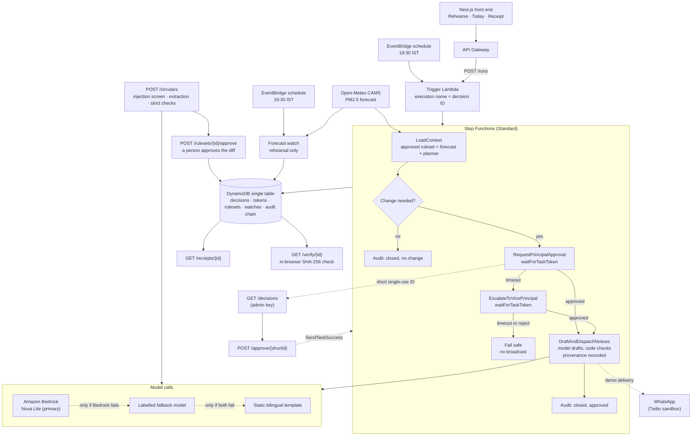

# Saans (साँस): the bad-air school day, re-planned and proven

<p align="center">
  <strong>Reads the order. Re-plans the day. Proves it.</strong><br>
  <em>A serverless AWS system that turns Delhi-NCR GRAP air-pollution orders into a safe, approved school timetable,
  bilingual notices, and a public receipt anyone can verify in their browser.</em>
</p>

<p align="center">
  
  
  
  
  
  
  
</p>

---

## For judges: the 5-minute tour

**1. Try the live system** (no account or key needed):

| Try | What you'll see |
| :--- | :--- |
| [`/health`](https://367bcz1ry5.execute-api.us-east-1.amazonaws.com/Prod/health) | The declared GRAP stage, whether the forecast is live or replayed, which model is answering, and the audit-chain head |
| [`/circulars`](https://367bcz1ry5.execute-api.us-east-1.amazonaws.com/Prod/circulars) | Paste a government order, or pick a sample. Choose the hostile one and watch code refuse it |
| `curl -X POST https://367bcz1ry5.execute-api.us-east-1.amazonaws.com/Prod/rehearse -d '{"stage":"IV"}'` | Tomorrow's timetable re-planned for Stage IV, with a reason for every period. Nothing is saved |

**2. Run it yourself** (about a minute; no AWS account, because every AWS service is faked in tests):

```bash
pip install -r requirements.txt -r requirements-dev.txt
python run_all_tests.py          # 265 tests
npm install && npm run dev       # the front end at http://localhost:3000, on the live API
```

**3. Read the code that matters:**

| Claim | Where it lives |
| :--- | :--- |
| A clean forecast never overrides a government ban | [services/rules/rules_engine.py](services/rules/rules_engine.py) |
| PE is moved or replaced, not cancelled, with no clashes | [services/planner/planner.py](services/planner/planner.py) |
| A person approves; no answer means nothing is sent | [services/workflow/state_machine.json](services/workflow/state_machine.json) |
| The AI proposes, code checks every rule and every number | [services/circular/validator.py](services/circular/validator.py), `check_notice` in [services/notify/drafting.py](services/notify/drafting.py) |
| Every decision is tamper-evident and checkable in the browser | [services/audit/hash_chain.py](services/audit/hash_chain.py), [services/audit/verify_page.html](services/audit/verify_page.html) |
| All of it as infrastructure-as-code | [infra/template.yaml](infra/template.yaml) |

**4. What we don't claim:** see [Known limitations](#known-limitations). The forecast is modelled, there has been no
pilot with a real school yet, and WhatsApp delivery only reaches demo phones.

---

## The problem

Every winter Delhi-NCR's air crosses into GRAP Stage III and IV. The Commission for Air Quality Management (CAQM) and
Delhi's Directorate of Education (DoE) then issue orders that halt outdoor sports and physical education (PE).

A principal gets that order late in the evening or early in the morning. They then have to:

1. **Work out what applies.** Which classes, which periods, from when, and what the forecast allows on top.
2. **Re-plan, not just cancel.** Cancelling PE leaves children sitting idle. The authorities ask schools to reschedule or
   provide alternatives.
3. **Tell everyone.** Teachers need the new plan. Parents need a notice in Hindi and English.
4. **Prove it later.** When an inspector or a parent asks what the school did and why, there is usually no record.

Saans does all four, keeps a person in charge of every decision, and leaves a tamper-evident trail.

## What happens on a bad-air day

```
           A new GRAP circular arrives
              │
              ├─ Bedrock reads it and proposes rules, each with a quote from the circular
              ├─ Code checks every rule against the circular's own words; a person approves the ruleset change
              ▼
19:30 IST  Scheduled run starts for tomorrow (one run per school, date and session; duplicates refused)
   │
   ├─ Load the declared GRAP stage, the approved ruleset, the timetable and the PM2.5 forecast
   ├─ Plan: move outdoor periods to cleaner permitted slots, or replace them with indoor active sessions
   │        in the cleanest free room; classes with sensitive students get stricter limits and choose first
   ├─ Ask the principal to approve  ──60 s, no answer──▶  ask the vice-principal  ──no answer──▶  fail safe
   │                                                                                           (nothing sent)
   ├─ Approved: Bedrock drafts teacher and parent notices (English + Hindi); code checks every number and link
   ├─ Notices go out as WhatsApp share links for class teachers (and, in the demo, straight to a phone)
   └─ Every step is appended to a SHA-256 hash chain; the public receipt re-verifies it in the browser
```

Separately, a **forecast watch** runs at 16:30 IST. It rehearses the plan for the next two school days and stores a
labelled contingency draft. It never declares a stage, never notifies anyone, and never creates a decision.

## Measured on the demo school

The demo school has 6 classes, 48 periods a day and 6 outdoor PE periods. These are the planner's own outputs on the
Stage III replay scenario. Exposure figures are modelled, not measured.

| Declared stage | Periods moved to a cleaner slot | Periods replaced indoors | PE minutes kept active | PE minutes lost | Modelled outdoor exposure cut |
| :--- | :---: | :---: | :---: | :---: | :---: |
| I or II | 1 | 5 | 240 of 240 | 0 | 95% |
| III or IV | 0 | 6 | 240 of 240 | 0 | 100% |

At every stage, three classes have students with respiratory conditions, so they get stricter forecast limits. The
indoor rooms chosen have a modelled 67–70% lower PM2.5 than outdoors, estimated from each room's ventilation type.

**Why Stage I–II matters most.** At Stage III and IV the order bans outdoor activity, so everything goes indoors. At
Stage I and II the order permits outdoor PE and the forecast decides. That is where Saans finds a cleaner slot that
no one would compute by hand, and explains why in a per-period `decision_trace`.

## Live on AWS

The backend is deployed as the CloudFormation stack `saans` in `us-east-1`.

```
https://367bcz1ry5.execute-api.us-east-1.amazonaws.com/Prod
```

| Endpoint | Method | Access | What it does |
| :--- | :--- | :--- | :--- |
| `/health` | GET | Public | Table, ruleset, declared stage, forecast freshness, Bedrock availability, fallback model, audit-chain head |
| `/forecast?hours=48` | GET | Public | Hourly PM2.5 with advisory and restricted thresholds and the first crossing. Cached for 1 hour |
| `/forecast?source=replay` | GET | Public | The labelled, hand-built Stage III scenario, for demos without network access |
| `/rehearse` | POST | Public | Re-plans tomorrow at any stage with no side effects. Powers the stage slider |
| `/runs` | POST | Admin key | Starts a decision run (same idempotent start as the scheduled trigger), for demos without a CLI |
| `/decisions` | GET | Admin key | The principal's brief: the plan, the drafted notices and the pending approval link |
| `/approve/{shortId}` | POST | Single-use link | The approver's answer. Resumes the paused workflow |
| `/watch` | GET | Admin key | Contingency drafts for the next two school days, and how to start a run for them |
| `/circulars` | GET | Public page | Paste a circular (or pick a sample), watch each step, approve the resulting change |
| `/circulars` | POST | Admin key | Injection screen, Bedrock extraction, strict code checks. Returns a candidate ruleset and its diff; changes nothing |
| `/rulesets/{candidateId}/approve` | POST | Admin key | Makes the candidate the ruleset the planner uses. Refused if the active ruleset changed since |
| `/rulesets/active` | GET | Public | The ruleset in use, its SHA-256, and whether it is the bundled one or a person approved it |
| `/receipts/{id}` | GET | Public | The decision's audit rows and the server's verdict on the chain |
| `/verify/{id}` | GET | Public | A self-contained page that recomputes every hash in your browser |

Admin endpoints need the `x-saans-admin-key` header. Responses carry counts only, never child-level data.

To smoke-test the deployment:

```bash
# reads the admin key from SAANS_ADMIN_KEY, or from the git-ignored infra/deploy.secrets
python scripts/test_live_api.py
```

## Architecture

<p align="center">
  
</p>

The detailed flow, every route and schedule:



All 16 Lambda functions share one bundle built by `scripts/build_lambda.py`. The infrastructure is one SAM template,
[infra/template.yaml](infra/template.yaml).

## Design principles, and where the code enforces them

| Principle | How it is enforced |
| :--- | :--- |
| **Order first, forecast second.** A clean forecast can never relax a stage ban. | `services/rules/rules_engine.py` classifies each period from the order before the forecast is considered. |
| **Re-plan, don't cancel.** | The planner tries a permitted cleaner slot first, then an indoor active session. It reports minutes moved, replaced and lost, computed from the timetable. |
| **Plan for forecast error.** | A swap must pass both the nominal forecast and a pessimistic one that is 20% higher. |
| **No clashes.** | Swaps are rejected if they double-book a teacher or a venue, or touch a locked period such as an exam. |
| **Sensitive children first.** | Classes with students who have respiratory conditions get scaled-down limits and pick slots and rooms first. Only counts are stored. |
| **A person decides.** | Nothing is sent without an approval. Step Functions holds the wait, escalates on timeout, and fails safe with no broadcast. A ruleset change from a circular also needs a person's approval. |
| **The model proposes, code decides.** | Bedrock reads circulars and drafts notices. Code refuses any rule whose quote is not verbatim or does not support its action, any rule that relaxes outdoor activity, and any notice with a number, link or script it was not given. |
| **Links can't be forged or replayed.** | Task tokens never leave the server. Approvers get a short ID bound to one decision and one role. It expires and is consumed with a conditional write. |
| **Runs happen once.** | The Step Functions execution name is the decision ID, so a second trigger for the same school, date and session is refused. A retried notify step never sends a message twice. |
| **Every claim is checkable.** | Each audit row hashes the previous row's hash plus its own canonical JSON. Appends are conditional on the chain head. The verify page recomputes the chain in the browser with Web Crypto. |
| **Fallbacks are labelled.** | If the live forecast fails, the replay scenario is used and marked `is_replay`. If Bedrock fails, the audit row says which fallback wrote the text and why. |
| **The AI's words are on the record too.** | For every notice, the `NOTICES_DRAFTED` row records the provider and model ID (or template ID), the prompt version, settings and SHA-256, the facts the writer was given, and the SHA-256 of the exact text. A parent can paste a WhatsApp notice into the receipt page and their browser checks it against the chain. |

## Rules come from the order: the model proposes, code checks, a person approves

Rules are versioned data. The bundled starting point is [data/demo/ruleset_v1.json](data/demo/ruleset_v1.json); a
ruleset a person approves is stored per school and used by the planner, the rehearsal and the forecast watch from then on.

Reading a new circular (`POST /circulars`, or the page at `GET /circulars`):

1. **Injection screen (code).** Known override phrases are refused before the model sees the text.
2. **Extraction (Bedrock).** The model returns candidate rules as JSON, each with a quote. The circular is passed as
   untrusted data, at temperature 0, with a versioned prompt (`circular-extract-v1`).
3. **Strict checks (code).** A rule is refused if its quote is not verbatim in the circular, if the quote does not
   mention what an action controls (a hybrid-mode sentence cannot ban sports), if it uses an unknown action or value,
   or if it sets outdoor activity to `allowed`. Relaxations can only be entered by a person.
4. **Merge (code).** Code assigns rule IDs and the source, not the model. A rule whose quote matches an active rule may
   tighten it, never loosen it (a weaker action or a higher minimum stage is refused). A circular never removes a rule.
5. **Approval (person).** The result is a candidate with a diff. Nothing changes until someone with the admin key
   approves it, and approval is refused if the active ruleset changed in the meantime.

Every read, including refusals and model failures, is a `CIRCULAR_READ` audit row with the circular's SHA-256, the
model, prompt version and hashes, and each accepted or refused rule with the reasons. Approval is a `RULESET_APPROVED`
row. The page offers three samples: the real DoE circular, a labelled demo Stage IV circular that hides one
relaxation, and the hostile override.

`scripts/eval_extraction.py` scores the live model on these circulars (expected rules found, forbidden rules
accepted) and writes `data/gold/extraction_eval.json`.

What the validator measured on the hand-entered rules, from [data/gold/eval_table.json](data/gold/eval_table.json):

| Check | Result |
| :--- | :--- |
| Real circulars in the gold set | 1 (DoE Delhi Stage III circular No. 40) |
| Hand-entered rules accepted with verbatim quotes | 3 of 3 |
| Injected "SYSTEM OVERRIDE" instruction | Refused |
| Invented quote | Refused |
| Accepted rules whose action is not supported by their quote | 2 of 3, listed as known gaps |

That last gap is now closed for model-extracted rules: strict mode refuses them. The two hand-entered rules stay in the
bundled ruleset as they were entered, and the table above keeps reporting them.

## Notices

Approved plans produce teacher and parent notices in English and Hindi. Every fact in a notice is read from the
approved plan. Indoor air figures are labelled as modelled. The teacher notice states how many classes had stricter
limits.

Bedrock drafts the notices through the Converse API. Nova Lite is the default, and the `BedrockModelId` stack
parameter switches to any other on-demand text model.

**Code checks the model's notice before it can be sent.** The draft is refused if it contains a number that is not
among the facts the model was given, a link other than this decision's receipt link, no receipt link, the wrong
script (Hindi must be mostly Devanagari), or more than 700 characters. A refused draft is replaced by the static
template, and the audit row records why (`fallback_reason`, `rejected_reasons`) and the SHA-256 of the refused text.
[data/gold/notice_replies.json](data/gold/notice_replies.json) holds 13 recorded replies, good and bad, that the
tests run through the check.

**A slow model cannot stall the run.** Each call has a 2 s connect and 8 s read timeout and one retry for transient
errors. The three notices share one deadline that ends before the Lambda's own timeout, and once Bedrock fails the
remaining notices stop waiting on it.

**Bedrock first, with a labelled fallback.** Every model call goes to Bedrock first. Only if Bedrock fails does an
optional second provider answer (a Groq-hosted Llama model, enabled by the `FallbackModelApiKey` stack parameter),
and only after that the static bilingual template. The code checks are the same whichever model wrote the text. Each
audit row records `model_provider` (`bedrock` or `fallback`), the model ID, why Bedrock was not used, and the prompt
version and settings, and `/health` reports `bedrock.usable` separately from the fallback.

### How notices reach parents

- **Click-to-share (the real channel).** Every notice comes with a WhatsApp share link. The class teacher taps it and
  sends the verified notice to the class parents' group they already run. Saans stores no parent phone numbers.
- **Demo delivery (WhatsApp).** When a WhatsApp provider is configured, the approved English and Hindi parent notices
  are also sent straight to the demo phones the moment the principal approves. The default is **Meta's WhatsApp Cloud
  API** with its free test number, which sends the real notice text to verified phones within 24 hours of the phone's
  last message to it. Twilio is supported too, but a Twilio trial account can only send Twilio's own templates
  (`TwilioContentSid`). Delivery is at most once per run, never fails the run, and is recorded as a
  `NOTICE_DELIVERED` audit row with the provider and each message's ID, status and text hash. Phones appear only as
  `demo-1`, `demo-2`; no number reaches the chain. This is for demonstrations, not for real parents.

**Check a notice you received.** The `/verify/{id}` page has a box where anyone can paste a notice. The browser hashes
it and finds the matching row, then shows which model or template wrote it and whether code refused a model draft.
Changing a single character makes the check fail.

Each plan also reports `exposure_averted_modelled`: outdoor PM2.5 × minutes before the plan, minus outdoor and modelled
indoor PM2.5 × minutes after it. On the demo school this is about 51,000 µg/m³·min at Stage III. It is recorded in the
`PLAN_GENERATED` audit row and shown on the receipt.

## Front end

A Next.js 16 app in `app/`, running on live data from the deployed API.

| Page | What it shows |
| :--- | :--- |
| `/` (Rehearse) | A 3D model of the demo school and the timetable re-planned live as you move the GRAP stage slider; click any coloured period to see exactly why |
| `/today` | The principal's brief: start a run, approve or reject with a countdown, then share the drafted notices |
| `/receipt` | Find a decision's receipt and check it in the browser, including "check a notice you received" |

Admin calls go through a small server-side proxy in `app/api/admin/`, so the admin key never reaches the browser.
Every API call times out after 6 s and retries once; if the API is still unreachable, the page shows a saved copy of a
real response from `public/snapshot/`, labelled as a snapshot, and switches back to live data when it can.

```bash
npm install
echo "SAANS_ADMIN_KEY=<your admin key>" > .env.local   # git-ignored; read only by the server-side proxy
npm run dev                                            # http://localhost:3000

npm run build && npm start                             # production build: use this for demos, it is much smoother
```

`NEXT_PUBLIC_SAANS_API` points the app at a different deployment; it defaults to the live API above.

The front end is hosted on AWS Amplify Hosting, which rebuilds it on every push using [amplify.yml](amplify.yml). The
backend is deployed separately with CloudFormation (see [Deploy to AWS](#deploy-to-aws)).

## Privacy and security

- **No child-level data.** Timetables are class-level. Teachers appear as codes. Sensitive students are stored as a
  count per class, and those counts never enter public responses or the public audit chain.
- **No parent phone numbers.** Click-to-share needs none. Demo delivery numbers live only in a hidden stack
  parameter and are recorded as `demo-1`, `demo-2`.
- **Roles, not names, in the audit chain.** The chain records `principal` or `vice_principal`, never a person.
- **The approver comes from the link, not the request.** Authority is read from the stored short-ID record.
- **Secrets are never committed.** The admin key, the fallback model key and the Twilio credentials are NoEcho stack
  parameters. Locally they live in the git-ignored `infra/.env`, `infra/deploy.secrets` and `.env.local`, and
  `scripts/deploy.py` passes them to CloudFormation without printing them. Tests check that no key appears in source.

A data-protection review under India's DPDP Act has not been done. It is required before any real pilot.

## Run it locally

Requires Python 3.10 or later.

```bash
git clone https://github.com/abhishekkamble12/Aethers_Ai.git
cd Aethers_Ai
python -m venv .venv
.venv/Scripts/activate            # Windows. On macOS or Linux: source .venv/bin/activate
pip install -r requirements.txt -r requirements-dev.txt

python run_all_tests.py           # full suite; AWS, Bedrock, the fallback model and Twilio are all faked
```

The tests cover planner edge cases, the approval workflow paths through the real state machine definition, the hash
chain under concurrent writers, the receipt verifier running the browser code under Node, forecast fallback and
caching, the forecast watch, notice wording and provenance, the notice output check against recorded replies, the
circular pipeline with scripted model replies, Bedrock-first failover, at-most-once WhatsApp delivery, the template's
freedom from dependency cycles, and the Lambda bundle importing every handler. 265 tests, all passing.

## Deploy to AWS

You need the AWS CLI with a named profile. The admin key is a secret you choose, at least 16 characters.

**First deploy:**

```bash
python scripts/build_lambda.py                         # bundles services/ and data/ into infra/.lambda_src

aws cloudformation package --template-file infra/template.yaml \
    --s3-bucket <your-artifact-bucket> --output-template-file infra/packaged.yaml

aws cloudformation deploy --template-file infra/packaged.yaml --stack-name saans \
    --region us-east-1 --capabilities CAPABILITY_IAM CAPABILITY_AUTO_EXPAND \
    --parameter-overrides AdminApiKey=<your-secret>      # optional: BedrockModelId=<model-id>

python scripts/seed_demo.py                            # reset the demo school and print the next commands
```

**Every deploy after that:**

```bash
python scripts/deploy.py          # builds, packages and deploys; optional secrets come from infra/.env
```

`infra/.env` is git-ignored. Every entry is optional; a missing one keeps its deployed value.

| `infra/.env` name | Stack parameter | Turns on |
| :--- | :--- | :--- |
| `FALLBACK_MODEL_API_KEY` (or `GROQ_API_KEY`) | `FallbackModelApiKey` | The labelled fallback model when Bedrock fails |
| `META_WA_TOKEN`, `META_WA_PHONE_NUMBER_ID` | `MetaWaToken`, `MetaWaPhoneNumberId` | Demo WhatsApp delivery through Meta's Cloud API (preferred) |
| `TWILIO_ACCOUNT_SID`, `TWILIO_AUTH_TOKEN` | `TwilioAccountSid`, `TwilioAuthToken` | Demo WhatsApp delivery through Twilio |
| `TWILIO_WHATSAPP_FROM` | `TwilioWhatsAppFrom` | The Twilio sender, e.g. `whatsapp:+14155238886` |
| `TWILIO_CONTENT_SID`, `TWILIO_CONTENT_VARIABLES` | `TwilioContentSid`, `TwilioContentVariables` | Twilio trial accounts: the template to send instead of free text |
| `DEMO_WHATSAPP_TO` | `DemoWhatsAppTo` | Comma-separated demo phones, e.g. `whatsapp:+91XXXXXXXXXX` |

For Meta: create an app at developers.facebook.com, add the WhatsApp product, add your phone as a recipient of the
test number, and create a permanent token for a system user. Before a demo, send any message from the demo phone to
the test number to open WhatsApp's 24-hour window.

Start a run from the front end's Today page, with `POST /runs`, or by invoking the Trigger Lambda (its name is the
`TriggerFunctionName` stack output):

```bash
aws lambda invoke --function-name <TriggerFunctionName> --cli-binary-format raw-in-base64-out \
    --payload '{"tenant_id": "TENANT#demo", "date": "2026-10-13", "forecast_source": "replay"}' out.json
```

## Repository map

```
services/
  rules/       order-first period classification
  planner/     deterministic planner, rehearsal API, run input validation
  forecast/    Open-Meteo ingest with labelled replay, GET /forecast, forecast watch, GET /watch
  workflow/    Step Functions definition, trigger, POST /runs, approval request, POST /approve, GET /decisions
  notify/      bilingual notice drafting, the output check, WhatsApp demo delivery
  audit/       hash chain, DynamoDB append, receipts, the /verify page
  circular/    Bedrock extraction, strict validator, ruleset diff and approval, /circulars page, evaluation
  health/      GET /health
  admin/       demo reset and seed
  common/      HTTP helpers, admin-key check, Bedrock call with timeouts, labelled fallback model
data/demo/     timetable, ruleset, venues, indoor-air factors, class profiles, replay scenario
data/gold/     the real DoE circular, a labelled sample circular, hostile fixtures, recorded model replies, evaluations
infra/         SAM template and deploy settings
scripts/       Lambda bundle build, deploy, demo seed, live API smoke test, live extraction eval
tests/         unit and integration tests (moto for AWS)
app/           Next.js pages and the server-side admin proxy
components/    front-end components (3D school scene, timetable, brief, receipt)
lib/           API client, types, translations (English, Hindi, Tamil)
public/        static assets and labelled API snapshots
docs/          architecture diagram, demo script, blog draft; docs/archive/ holds the build-phase plans that test
               and code comments cite (e.g. "hack_win M3")
```

See [CONTRIBUTING.md](CONTRIBUTING.md) to extend it and [CHANGELOG.md](CHANGELOG.md) for what changed when.

## Known limitations

- **The forecast is modelled.** It is CAMS data via Open-Meteo for one grid point, not a ground station reading.
- **Bedrock is not yet answering on the demo account.** The account was moved off the Free plan, but Bedrock still
  returns `ValidationException: Operation not allowed` while access activates. Until it does, the labelled fallback
  model answers when configured, otherwise notices use the static template and circulars cannot be read.
  `/health` and every audit row show which.
- **The extraction test set is small:** one real circular, one labelled sample and one hostile case.
- **Ruleset approval uses the admin key**, not the principal's role-bound link that plan approval uses.
- **The output check reads digits, not number words.** "Six periods" in a model notice is not checked.
- **Automatic delivery is a demo.** It reaches only verified test phones, and free text only within WhatsApp's
  24-hour window. Real parents are reached through the class teacher's share link; there is no WhatsApp Business registration.
- **Approvals happen through the brief.** There is no Telegram or SMS approval yet.
- **No pilot has run** with a real school, and no school or student counts are claimed.
- **Tamper-evident, not tamper-proof.** The chain shows any edit, but we operate the database.

## Roadmap

1. Anchor the chain head daily in an S3 bucket with Object Lock, so even we cannot rewrite history unnoticed.
2. Principal approvals by Telegram, with the same single-use, role-bound links.
3. A larger hand-labelled set of real CAQM and DoE circulars for the extraction evaluation; ruleset approval through
   the principal's role-bound link; Cognito sign-in instead of the shared admin key.
4. A pilot with one Delhi school for one winter, after a DPDP review.
5. Other rulesets as data: other NCR states, heat-action-plan circulars, and school bus timings that shift with the day.

## Sources

- Directorate of Education, Delhi.
  [Circular No. DE.23(28)/Sch.Br./2025/40, 17 January 2025](https://edudel.nic.in/upload/upload_2025_26/40_dt_17012025sch.pdf),
  implementing CAQM Direction No. 84 (Stage III). The text used for validation is in
  [data/gold/circular_real_caqm.txt](data/gold/circular_real_caqm.txt).
- [CAQM enforces GRAP Stage IV measures, 14 December 2025](https://newsonair.gov.in/caqm-enforces-grap-iv-measures-as-delhi-ncr-air-quality-worsens/).
- Forecast data: [Open-Meteo Air Quality API](https://open-meteo.com/en/docs/air-quality-api), CAMS model.

## License

MIT. See [LICENSE](LICENSE).
